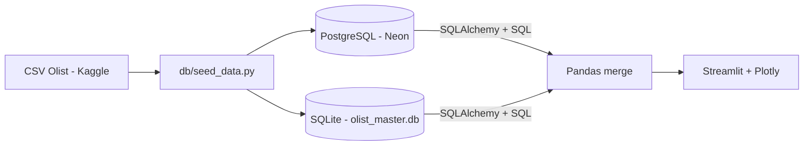

# Olist E-Commerce Dashboard (Multi-DBMS Data Pipeline)

Tugas Mandiri Terstruktur, Mata Kuliah **Visualisasi Data dan Informasi**, Program Studi Informatika.

## Identitas

- **Nama Lengkap:** Arief Cahya Subagja
- **NIM:** 230660121063

## Tautan Utama

| Keterangan | URL |
|---|---|
| Live Web App | https://olist-visdat-arief.streamlit.app/ |
| Repositori GitHub | https://github.com/AriefCahyaSubagja15/AriefCS_Visdat |
| Sumber data asli (Kaggle) | https://www.kaggle.com/datasets/olistbr/brazilian-ecommerce |
| Referensi kode/proyek | https://github.com/pauloreis-ds/olist-database-postgresql |

## Deskripsi

Dashboard interaktif untuk menganalisis penjualan marketplace e-commerce Brasil (Olist, 2016-2018).
Data transaksi dan data master disimpan di **dua DBMS berbeda**, lalu digabungkan di tingkat aplikasi
menggunakan **Pandas** dan divisualisasikan dengan **Plotly** di atas **Streamlit**.

## Skenario Bisnis

Pada sistem e-commerce, data transaksi (order, item, pembayaran) bersifat besar dan sering berubah,
sedangkan data master (katalog produk, kategori, penjual, ulasan) bersifat referensi dan jarang berubah.
Memisahkan keduanya ke DBMS yang berbeda masuk akal secara arsitektur: transaksi di DBMS relasional
server (PostgreSQL), referensi di database embedded ringan (SQLite) yang mudah didistribusikan bersama aplikasi.

## Arsitektur

| DBMS | Engine | Fungsi | Tabel |
|---|---|---|---|
| DBMS 1 | PostgreSQL (Neon, cloud) | Data transaksi utama | `customers`, `orders`, `order_items`, `order_payments` |
| DBMS 2 | SQLite (file lokal di repo) | Data master dan referensi | `products`, `product_category_translation`, `sellers`, `order_reviews` |



### Alur Integrasi (Data Pipeline)

1. `db/seed_data.py` membaca CSV Olist, lalu mengisi PostgreSQL (transaksi) dan SQLite (master).
2. `app.py` mengueri **setiap DBMS secara terpisah** lewat SQLAlchemy dan `pandas.read_sql_query()`.
3. Hasilnya digabung di Pandas dengan `merge()`:
   - transaksi (PostgreSQL) dengan produk dan kategori (SQLite) melalui `product_id`
   - transaksi dengan penjual (SQLite) melalui `seller_id`
   - transaksi dengan rata-rata skor ulasan (SQLite) melalui `order_id`
4. DataFrame gabungan difilter dan divisualisasikan dengan Plotly di Streamlit.

Tidak ada foreign key lintas DBMS (tidak didukung oleh database), sehingga relasi antar kedua
DBMS dijaga di tingkat aplikasi.

## Fitur Interaktivitas

- Filter rentang tanggal pembelian, status order, dan negara bagian pembeli (sidebar)
- Slider jumlah kategori teratas
- Ringkasan KPI: total omzet, jumlah order, rata-rata nilai order, rata-rata skor ulasan
- Empat tab: **Tren** (omzet dan order bulanan, metode pembayaran), **Kategori** (omzet per kategori,
  omzet vs skor ulasan), **Geografi** (pembeli vs penjual per negara bagian, heatmap rute),
  **Arsitektur & Data** (penjelasan arsitektur dan cuplikan data gabungan)
- Grafik Plotly interaktif (hover, zoom, pan)

## Struktur Repositori

```
.
├── app.py                  # Aplikasi Streamlit
├── requirements.txt        # Dependensi Python
├── .env.example            # Contoh konfigurasi (salin menjadi .env)
├── .gitignore
├── README.md
└── db/
    ├── schema_postgres.sql # DDL PostgreSQL
    ├── schema_sqlite.sql   # DDL SQLite
    ├── seed_data.py        # Skrip migrasi/seed dari CSV ke kedua DBMS
    └── olist_master.db     # Database SQLite hasil seed
```

Folder `data/` (CSV mentah dari Kaggle) tidak disertakan di repositori karena ukurannya besar.

## Cara Menjalankan Secara Lokal

1. **Unduh dataset** dari Kaggle ([tautan](https://www.kaggle.com/datasets/olistbr/brazilian-ecommerce)),
   ekstrak, lalu letakkan 9 file CSV di folder `data/`.
2. **Siapkan PostgreSQL**: buat database gratis di [Neon](https://neon.tech), lalu salin connection string-nya.
3. **Atur kredensial**: salin `.env.example` menjadi `.env`, isi `DATABASE_URL` dengan connection string Neon.
4. **Install dependensi**:
   ```bash
   python -m venv .venv
   # Windows: .venv\Scripts\activate   |   Mac/Linux: source .venv/bin/activate
   pip install -r requirements.txt
   ```
5. **Isi kedua database**:
   ```bash
   python db/seed_data.py            # kedua DBMS
   python db/seed_data.py postgres   # hanya PostgreSQL
   python db/seed_data.py sqlite     # hanya SQLite
   ```
6. **Jalankan aplikasi**:
   ```bash
   streamlit run app.py
   ```

## Deployment

Aplikasi di-deploy ke Streamlit Community Cloud. Kredensial PostgreSQL disimpan di **Secrets**
(`DATABASE_URL`) dan tidak ditulis di dalam kode. File `.env` tidak diunggah ke repositori.

## Sumber Data dan Atribusi

- Dataset: *Brazilian E-Commerce Public Dataset by Olist* (Kaggle),
  https://www.kaggle.com/datasets/olistbr/brazilian-ecommerce
- Lisensi dataset: CC BY-NC-SA 4.0 (non-komersial, share-alike). Data dibuat dan dibagikan oleh Olist.
- Proyek ini dibuat untuk keperluan akademik (non-komersial).

## Referensi Kode

**Repositori publik yang dipelajari:**
- olist-database-postgresql (pauloreis-ds) - https://github.com/pauloreis-ds/olist-database-postgresql
  Dipelajari sebagai contoh penggunaan dataset Olist pada database PostgreSQL.

**Dokumentasi yang dirujuk:**
- Streamlit: https://docs.streamlit.io
- Plotly Express: https://plotly.com/python/plotly-express/
- SQLAlchemy: https://docs.sqlalchemy.org
